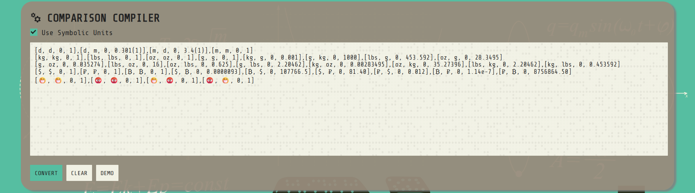
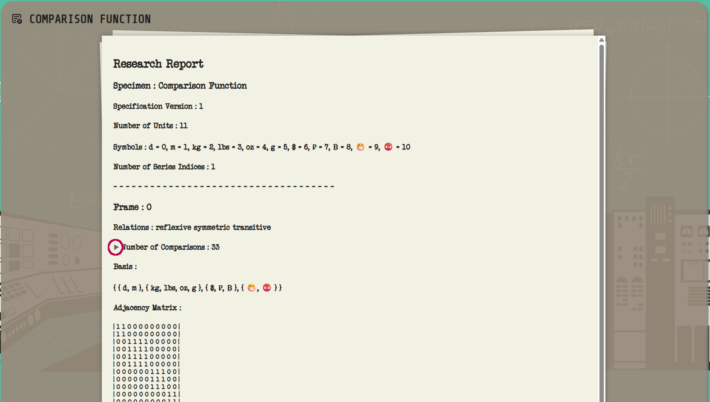
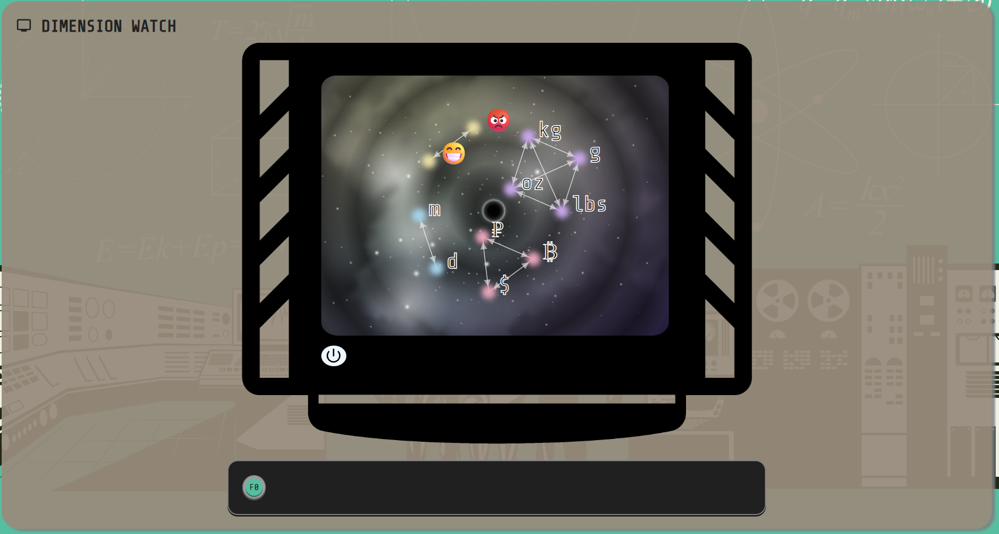
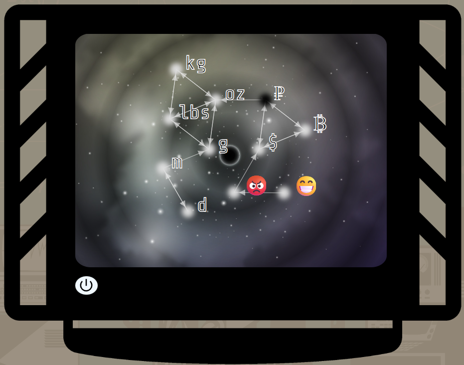

> NEWS! The new visualization tool is live at [https://androlo.github.io/complab/](https://androlo.github.io/complab/). More info below.

# The Comparison Framework


### Build structural physics models directly from measurement data.

The Comparison Framework (SI 2.0) is a blueprint for constructing structural physics models from raw measurements. It is similar to the SI, but instead of assuming units and dimensions up front it derives them from the data itself, with full provenance and transparency. It also extends a lot of the SI's functionality.

### What questions does it answer?

If you’ve ever asked:

*What is a physical unit?*

*Why does the SI system look the way it does?*

*What are dimensions like length and time, and why do they appear in equations?*

*What can and can’t we do with units (e.g., why can’t we add meters and seconds)?*

*Why do composite units arise?*

*Why do we need dimensional balance?*

…the framework provides clear, rigorous, and simple answers grounded in elementary mathematics.

### Core ideas

#### Data-first units & dimensions
Units, dimensions, and related structures are generated from datasets, not prescribed in advance.

#### Transparent provenance
Every element of a model can be traced back to the originating data. The generation process is auditable end-to-end.

#### Mathematical simplicity
Relies on elementary algebra, linear algebra, function theory, and graph theory—not on quantity calculus.

#### Flexibility over convenience
It asks a bit more from the client but is more versatile and configurable—think of it as “the Linux of physics data processing frameworks.”

### Why it matters

By deriving structure from data, the framework gives principled answers to how dimensions and units emerge and behave. This lets you build logically sound models that respect what the data can (and cannot) support.

### How it differs from SI

SI: Dimensions and units are fixed beforehand; datasets must conform.

Comparison Framework: Dimensions and units are inferred from relationships in the data, with explicit justification and traceability.

The result is not a rejection of SI but a complementary approach that exposes the logical foundations SI rests on—and broadens them.

### When to use it

You need reproducible, inspectable model generation from measurements.

You want to avoid hard-coding unit systems and instead infer structure.

You care about the logic underpinning units, dimensions, and composite quantities.

### Philosophy & background (optional reading)

The repository includes short essays on the philosophy of measurement, the processing of measurements, and some history of how physics handled data—from the ancient Greeks to modern practice. These sections explore the boundary where physical observation meets abstract structure and how modeling choices shape what we can claim from data.

## Downloading

The most recent document is always available in the [Releases section](https://github.com/androlo/comparison_framework/releases).

The document is versioned, meaning you can always look at the front page of your document and compare it with the most recently published document to see if it is up to date. It will have the label "draft," and versions of the form 0.X.Y, until the first edition (which is planned for mid 2026). Afterward, it will have versions of the form X.Y.Z where X is the edition number.

There is no reason to have any version but the latest.

About the progress of the document: The first draft version made public had version 0.16.0, so if the current version is 0.18.5 at some point, that means the document has gone through two larger revisions and then five smaller fixes after that. As of right now (0.17), the document will probably go to 1.0 after 0.18.

## Software and visualization tools

### Educational software

A typescript implementation of this framework is available at [https://github.com/androlo/complibjs](https://github.com/androlo/complibjs).

### Visualization

[https://androlo.github.io/complab/](https://androlo.github.io/complab/).

> **Note:** This is a simple visualization tool used by the developer. It's provided as an educational tool, not an industrial-grade product.

To get a first-time overview, follow these steps:

1. Click the **DEMO** button below the comparison input area. This fills the input field with example comparisons.
2. Click the **CONVERT** button next to **DEMO**. This places the comparisons—without labels and with interval values—into the output area.
3. Click the **EVALUATE** button below the comparison output area.



A demo comparison function is then created and presented below.

#### Comparison function presentation

The comparison function presentation document contains information about the comparison function and is largely self-explanatory. Note that the sections **Number of Comparisons** and **Orthogonal Substructure** can be expanded by clicking the triangles next to their titles.



#### Network visualization

At the bottom of the page is a network visualization of the comparison function. It becomes active after a comparison function has been evaluated. Click the power button on the TV to show the contents. The buttons on the bar below the TV (**F0**, **F1**, …) can be used to switch between available frames.

In the graph, each node represents a unit, and its label appears next to it. Arrows and colors indicate relationships:

- A colored (non-black) node indicates that the unit is reflexive (i.e., `f(u, u, s)` is non-null for the given series index `s`).
- An arrow from node **a** to node **b** indicates that `f(a, b, s)` is non-null for the given series index `s`. A bidirectional arrow indicates that `f(b, a, s)` is non-null as well.

When a comparison function is orthogonal, nodes have different colors depending on their base class.



Otherwise, all nodes are white (reflexive) or black (non-reflexive).



#### Additional features

The **Use Symbolic Units** checkbox (above the comparison input area) lets you use symbols for units instead of numbers. The system automatically assigns numbers to symbols in order of appearance. These symbols are also used in the presentation.

The **CLEAR** button (below the comparison input area) clears the comparisons from both the input and output areas.

#### Rules for comparisons

Comparisons are entered in the form `[u1, u2, s, x]`, where `u1` and `u2` are units, `s` is a series index, and `x` is a value. Values use scientific notation:

```
Number grammar:
  sign? ( digits [ '.' digits? ] | '.' digits ) ( '(' digits ')' )? ( [eE] sign? digits )?
Examples: 12, -3.4, +.5, 1.(2), 3.40(12), 3.40e-2, -1.2(3)E+4
```

Uncertainties are given in parentheses and interpreted as a simple ± relative to the last digit. For example, `1.2(1)` means `1.2 ± 0.1`, i.e., the interval `[1.1, 1.3]`.

You can provide multiple comparisons as a list by either:
1. Writing them consecutively: ``[a, b, s, x][c, d, t, y]...``
2. Separating them with commas: ``[a, b, s, x],[c, d, t, y], ...``

All whitespace between comparisons (spaces, tabs, newlines) is ignored.

## Error-reporting

Report errors in the issue tracker. Please include what’s wrong and where to find it (ideally the document version and page number). Tags are not necessary.

## Roadmap

The first edition of the document will be released once a few more kinks has been ironed out. There are no plans of adding any new sections, other than maybe a few minor ones that has been postponed for a long time.

After the first edition is completed, the document will not just be refined, but it will be separated into two parts: the specification and the educational material. Right now, it is a grab-bag, containing many different things: definitions, some proofs, some learning material, etc. The second version of the document will only contain a "raw" spec, and the educational material will be broken out - either to another document or to an educational webpage (text, interactive material, etc.)

Thus, one can think of the current doc and implementation as an MVP, or a demonstration. The second iteration will be about making an actual, competitive product.

## Copyright information

The text and underlying material in this document are free to use—like any scientific work—under standard rules of academic integrity. The images, however, are copyrighted by their creators (via Shutterstock/iStock/etc.) and therefore may not be used freely. You may download and read the document, keep copies, and extract text, but you may not extract images from the document for other uses.

The program is distributed without any warranty or guarantees. It is provided “as is,” and the author is not responsible for any damage caused by its use.

## About the state of the document

This document is still a draft, but should be published as a First Edition early 2026.

The "special unit functions" and "algebraic structures" appendices are still in progress. The protocol appendix has only been added in as a placeholder. They might be removed for the first edition.

The proofs should be sound, but needs improvement.
